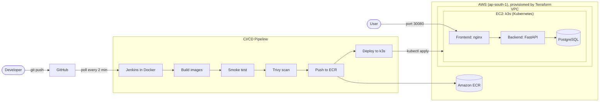

# 🏍️ Showroom: Full-Stack App with an End-to-End DevOps Pipeline

A bike showroom management app (customer panel + admin panel), built to practise a real DevOps workflow: **Docker → Kubernetes → Terraform → Jenkins CI/CD on AWS**.

Every `git push` to `main` is built, scanned, pushed to Amazon ECR and rolled out to a Kubernetes cluster on AWS, with no manual steps.

---

## Architecture



## What the app does

| Role | Features |
|---|---|
| **Customer** | Register / login, get a permanent customer ID (e.g. `SR-1002`), send bike enquiries, view insurance policies with Active / Expiring soon / Expired status, view service history |
| **Admin** | Dashboard stats, sales pipeline (status, follow-up date, notes), customer list, add service records, add insurance policies by customer ID |

## Tech stack

| Layer | Tools |
|---|---|
| Frontend | React (Vite), React Router, nginx |
| Backend | Python, FastAPI, SQLAlchemy, JWT auth, bcrypt |
| Database | PostgreSQL (SQLite for local dev) |
| Containers | Docker (multi-stage builds), Docker Compose |
| Orchestration | Kubernetes (kind locally, k3s on EC2) |
| Infrastructure as Code | Terraform (VPC, subnet, IGW, security group, ECR, IAM, EC2) |
| CI/CD | Jenkins (Pipeline as Code), Trivy image scanning |
| Cloud | AWS (EC2, ECR, VPC, IAM) |

## Repository structure

```
showroom/
├── backend/            FastAPI app, Dockerfile
├── frontend/           React app, Dockerfile, nginx.conf
├── k8s/                Kubernetes manifests (namespace, secret, postgres, backend, frontend)
├── terraform/          AWS infrastructure as code
├── jenkins/            Dockerfile for the Jenkins image (Docker CLI, kubectl, AWS CLI)
├── Jenkinsfile         CI/CD pipeline definition
├── docker-compose.yml  Run the whole stack locally
├── kind-config.yaml    Local Kubernetes cluster config
└── docs/               Screenshots
```

## CI/CD pipeline

| # | Stage | What it does |
|---|---|---|
| 1 | Checkout | Pulls the latest code from GitHub |
| 2 | Build images | Builds backend and frontend images tagged with the build number |
| 3 | Smoke test | Starts the backend image and checks the app imports cleanly |
| 4 | Security scan | Trivy scans the image for HIGH / CRITICAL vulnerabilities |
| 5 | Push to ECR | Authenticates with a least-privilege IAM user and pushes both images |
| 6 | Deploy to k3s | Applies the manifests with the new image tags, then waits for the rollout to finish |

Jenkins uses a dedicated IAM user (`jenkins-ci`) that can only access ECR, and credentials are stored in the Jenkins credential store, never in the repo.

## Run it

### 1. Local development (no Docker)

```bash
# backend
cd backend
python -m venv venv && source venv/bin/activate   # Windows: .\venv\Scripts\Activate.ps1
pip install -r requirements.txt
uvicorn app.main:app --reload                      # http://localhost:8000/docs

# frontend (new terminal)
cd frontend
npm install
npm run dev                                        # http://localhost:5173
```

### 2. Docker Compose (app + PostgreSQL)

```bash
docker compose up --build                          # http://localhost:8080
```

### 3. Local Kubernetes with kind

```bash
kind create cluster --name showroom --config kind-config.yaml
docker build -t showroom-backend:1.0 ./backend
docker build -t showroom-frontend:1.0 ./frontend
kind load docker-image showroom-backend:1.0 showroom-frontend:1.0 --name showroom
kubectl apply -f k8s/                              # http://localhost:8080
```

### 4. AWS (Terraform + Jenkins)

```bash
cd terraform
# set my_ip_cidr = "<your-ip>/32" in terraform.tfvars
terraform init
terraform apply
terraform output app_url
```

Then run Jenkins (`jenkins/Dockerfile`), add the `aws-creds` and `k3s-kubeconfig` credentials, create a Pipeline job from this repo, and push a commit.

**Tear down to avoid AWS charges:**

```bash
terraform destroy
```

## Default admin login (development only)

| Email | Password |
|---|---|
| `admin@showroom.com` | `admin123` |

Change these through the `ADMIN_EMAIL` and `ADMIN_PASSWORD` environment variables for any real deployment.

## API overview

| Area | Endpoints |
|---|---|
| Auth | `POST /api/auth/register`, `POST /api/auth/login`, `GET /api/auth/me`, `GET /api/auth/customers` (admin) |
| Enquiries | `POST /api/enquiries`, `GET /api/enquiries/mine`, `GET /api/enquiries` (admin), `PATCH /api/enquiries/{id}` (admin) |
| Services | `POST /api/services` (admin), `GET /api/services/mine`, `GET /api/services` (admin) |
| Insurance | `POST /api/insurance` (admin), `GET /api/insurance/mine`, `GET /api/insurance` (admin) |
| Health | `GET /health` (used by Kubernetes probes) |

Interactive docs are available at `/docs` when the backend is running.

## Screenshots

| | |
|---|---|
|  |  |
|  |  |

## What I learned

- Containerising a full-stack app with multi-stage Docker builds
- Writing Kubernetes manifests: Deployments, Services, Secrets, PVCs, health probes, resource limits and rolling updates
- Provisioning cloud infrastructure repeatably with Terraform, including destroy and recreate
- Building a Jenkins pipeline that builds, scans, publishes and deploys automatically
- Debugging real issues: network and firewall rules, image pull authentication, credentials handling

## Author

**Vishnu Sankar AP**: [GitHub](https://github.com/vishnu-sankar-ap)